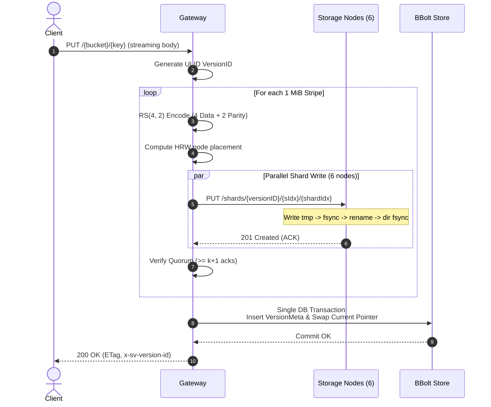
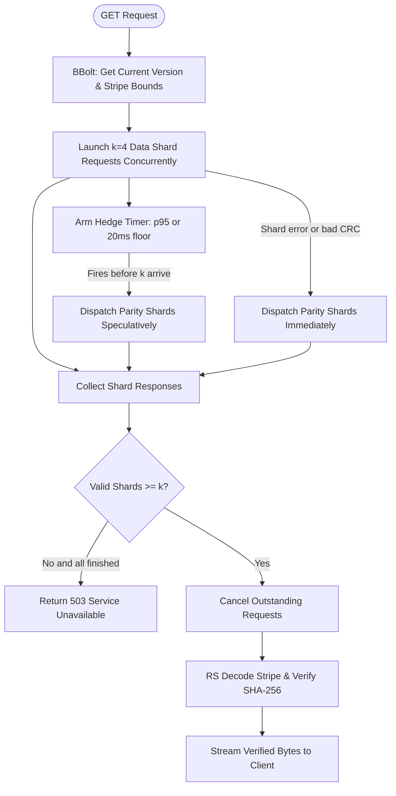

# ShardVault Design & Architecture

`shardvault` is a lightweight, high-reliability S3-compatible object store written in Go. It implements Reed-Solomon erasure coding ($k=4, m=2$) across storage nodes, rendezvous hashing for deterministic placement, atomic version commits over embedded metadata, speculative hedged reads, background bitrot scrubbing and repair, and safe garbage collection.

---

## 1. Storage Durability: Reed-Solomon (4, 2) vs 3× Replication

Distributed storage systems face a fundamental trade-off between hardware cost, network repair traffic, and fault tolerance:

| Metric | 3× Replication | ShardVault RS($k=4, m=2$) |
| :--- | :--- | :--- |
| **Storage Overhead** | **3.00×** (200% redundant storage) | **1.50×** (50% redundant storage) |
| **Fault Tolerance** | Any 2 node failures | Any 2 node failures |
| **Disk Write Amplification** | 3× logical payload | 1.5× logical payload |
| **Network Write Traffic** | 3× payload streamed across nodes | 1.5× payload streamed across nodes |
| **Reconstruction Read Cost** | Read 1 replica (1×) | Read $k=4$ healthy shards (1× logical stripe) |
| **Failure Combinations** | Survives 2 node losses | Survives all $\binom{6}{2} = 15$ two-node loss patterns |

### The Durability Invariant
With RS(4, 2), every stripe of data is divided into $k=4$ equal-sized data shards and $m=2$ Cauchy-based Reed-Solomon parity shards. As long as any $k=4$ out of the $k+m=6$ shards are accessible and valid, the original payload can be mathematically reconstructed through Galois Field matrix inversion ($GF(2^8)$).

---

## 2. Stripe & Shard Layout

Objects are divided into sequential stripes of fixed size $S$ (default 1 MiB):

```
Object Payload: [================================ 2.4 MiB ================================]
                     |                                |                           |
                 Stripe 0 (1 MiB)                 Stripe 1 (1 MiB)            Stripe 2 (0.4 MiB, padded to 1 MiB)
                     |                                |                           |
               RS(4, 2) Encode                  RS(4, 2) Encode             RS(4, 2) Encode
          /   /   |   |   \   \            /   /   |   |   \   \       /   /   |   |   \   \
         D0  D1  D2  D3  P0  P1           D0  D1  D2  D3  P0  P1      D0  D1  D2  D3  P0  P1
```

Each shard on disk contains a 54-byte fixed binary header followed by the shard payload:

```
+---------------------------------------------------------------------------------------+
| Magic (4B) | Ver (2B) | VersionID (26B ULID) | StripeIdx (4B) | ShardIdx (2B)         |
| 0x53564C54 |   0x01   |  e.g. 01M4JREZ...    |   uint32       |  uint16               |
+---------------------------------------------------------------------------------------+
| DataLen (8B)           | DataCRC32C (4B)     | Shard Payload (DataLen bytes)          |
| uint64                 | Castagnoli CRC32C   | Raw shard bytes                        |
+---------------------------------------------------------------------------------------+
```

- **CRC32C (Castagnoli)** in the header covers the shard payload. Storage nodes verify this CRC on read.
- **SHA-256** is computed over the entire stripe data before encoding and stored in the metadata catalog. This guarantees end-to-end detection of corruptions even if a storage node or network layer were compromised.

---

## 3. Deterministic Placement via Rendezvous (HRW) Hashing

Instead of maintaining a centralised placement map or consistent hashing ring, `shardvault` uses **Highest Random Weight (HRW) / Rendezvous Hashing**:

1. For version $V$ and stripe $s$, the placement key is `V/s`.
2. For each storage node $N_i$, compute weight:
   $$W(N_i, \text{key}) = \text{CRC32}(\text{key} \parallel N_i)$$
3. Sort nodes in descending order of weight.
4. Select the top $k+m$ distinct nodes. Node $0 \dots k-1$ receive data shards; nodes $k \dots k+m-1$ receive parity shards.

### Properties
- **Minimal Disruption**: Adding or removing a node only moves $\frac{1}{N}$ of keys.
- **Uniform Distribution**: Uniform distribution across nodes without manual rebalancing.
- **Deterministic**: Any worker or repair process can determine the designated nodes for any shard without extra network round-trips.

---

## 4. Metadata Store: Why BBolt?

`shardvault` embeds **BBolt** (`go.etcd.io/bbolt`) as its metadata store.

### Architectural Rationale
1. **Pure Go / Zero CGO**: SQLite through modernc is pure Go, but BBolt has zero external dependencies, minimal memory footprint, and compile-time determinism across OS targets.
2. **ACID Single-File Architecture**: BBolt enforces strict ACID transactions with single-writer, multi-reader semantics using a memory-mapped B+ tree (`mmap`).
3. **Atomic Pointer Swaps**: A metadata commit requires updating the active object reference and inserting version metadata atomically within a single database transaction.

### Schema Layout
- `buckets`: Set of bucket names.
- `objects`: Map of `bucket/key` $\to$ `current_version_id` (or `DELETED` delete marker).
- `versions`: Map of `version_id` $\to$ `VersionMeta` JSON (size, etag, stripe count, shard locations, missing list, stripe SHAs).

---

## 5. Write Path & Atomic Commit Protocol



### Why Write Quorum is $k+1$ (5 out of 6)
- If write quorum were set to $k=4$, a write could succeed when 2 nodes fail ($m=2$). However, this would commit an object with **zero redundancy left on day zero** (a single subsequent failure causes data loss).
- Setting write quorum to $k+1=5$ guarantees that **at least one parity shard is written and confirmed** before the object is committed. Any unwritten 6th shard is recorded in the `missing` list in metadata, and the background scrubber immediately reconstructs it to restore full $m=2$ redundancy.
- If fewer than $k+1$ nodes acknowledge, the PUT aborts with `503 ServiceUnavailable`, and no metadata is committed.

### Crash Safety & Invisible Orphans
If the gateway crashes mid-upload or is killed with `SIGKILL`:
- Shards written to storage nodes are **orphans** because they are not referenced in the BBolt `objects` catalog.
- Readers querying the key see either the previous version or `404 NoSuchKey`—never a partial or half-written object.
- The background garbage collector detects uncommitted shards older than the grace period (default 10 minutes) and deletes them cleanly.

---

## 6. Read Path & Speculative Hedging



### Dynamic Hedged Reads
Storage nodes occasionally suffer tail latency due to disk contention, GC, or network jitter.
- The gateway requests the $k=4$ data shards first.
- If any node fails or returns a CRC mismatch (`x-sv-corrupt: 1`), parity shards are launched immediately.
- If all $k$ shards have not arrived within the hedge delay (observed p95 or 20ms floor), parity shards are launched speculatively.
- As soon as **any $k=4$ valid shards arrive**, outstanding HTTP requests are cancelled, the stripe is reconstructed, its SHA-256 is verified, and bytes are streamed to the client.

---

## 7. Scrubber, Reconstruction & Garbage Collection

### Bitrot Detection & Repair
1. The background scrubber walks all active object versions.
2. It fetches headers and validates CRC32C checksums across all $k+m$ shards.
3. If any shard is missing or corrupt:
   - It reads $k$ healthy shards and reconstructs the damaged shard in memory.
   - It writes the reconstructed shard to its HRW-designated node (or next node in weight order if that node is unreachable).
   - It updates the metadata transactionally.
4. Metric `stripes_at_risk` tracks stripes with fewer than $k+m$ healthy shards.

### Safe Garbage Collection
- Storage nodes list on-disk shards via `GET /shards`.
- The GC worker parses the ULID timestamp encoded in the shard path.
- Shards with no committed version that are older than the grace period are deleted. Shards created within the grace period are preserved to avoid race conditions with in-flight concurrent PUT requests.
