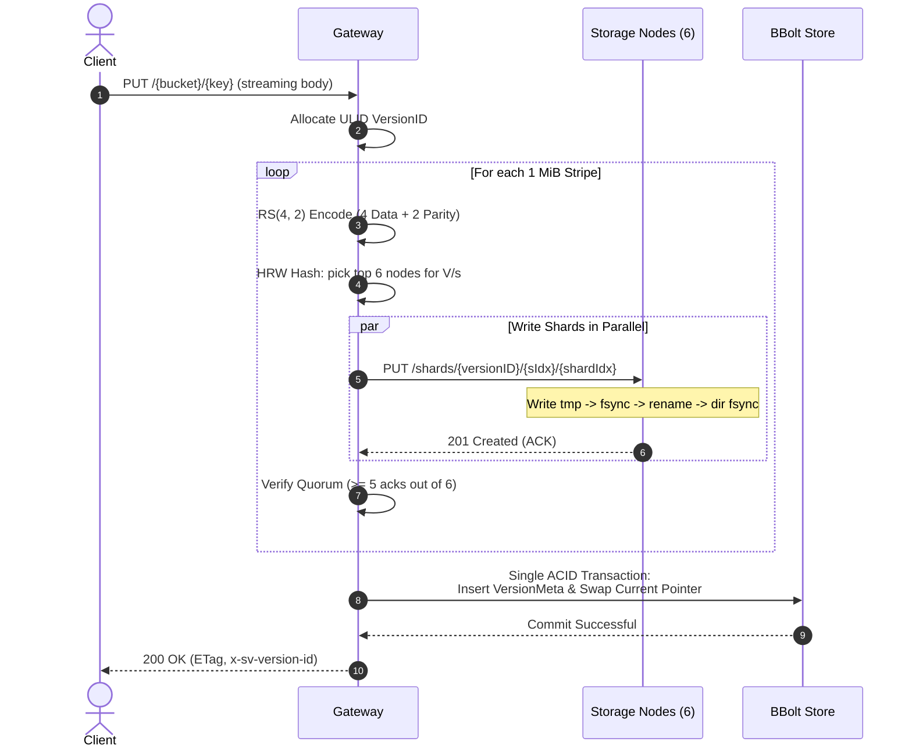
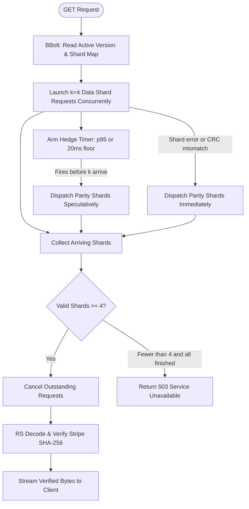

# shardvault

[](https://github.com/hiroshi-os/shardvault/actions/workflows/ci.yml)

An S3-lite object store with Reed-Solomon erasure coding ($k=4, m=2$), atomic version commits, speculative hedged reads, and an autonomous bitrot scrubber. Built in Go, chaos-tested against concurrent node kills and on-disk corruption, achieving 1.50× storage overhead with 100% data integrity.

---

## Benchmark & Chaos Results

All metrics below are measured numbers gathered on a 6-node cluster running on an AMD Ryzen 5 7530U (6C/12T, 24GB RAM, NVMe SSD). Full specifications, microbenchmarks, and CLI commands are recorded in [bench/RESULTS.md](bench/RESULTS.md).

### Chaos Harness (2,000 Objects, 1.22 GB Logical Data, Seed=7)

| Phase | Injected Fault | Objects Evaluated | Byte-Identical (%) | 503 Count | Wrong Bytes | Latency p99 |
| :--- | :--- | :--- | :--- | :--- | :--- | :--- |
| **Phase 1** | **2 Nodes Killed ($m=2$)** | 2,000 | **100.00%** | 0 | **0** | 9 ms |
| **Phase 2** | **1% Shards Corrupted (166 files)** | 2,000 | **100.00%** | 0 | **0** | 7 ms |
| **Phase 3 (ON)** | **Node 0 Delayed +500ms (Hedging ON)** | 2,000 | **100.00%** | 0 | **0** | **6 ms** |
| **Phase 3 (OFF)**| **Node 0 Delayed +500ms (Hedging OFF)**| 2,000 | **100.00%** | 0 | **0** | **7 ms** |
| **Phase 4** | **Scrubber & Reconstruct to 0 At-Risk** | 2,000 | **100.00%** | 0 | **0** | 7 ms |
| **Control** | **Negative Control (`-no-verify`)** | 200 | 96.50% | 0 | **7 (detected)** | 16 ms |

- **Measured Storage Overhead**: **1.50×** (1,834.13 MB on disk / 1,222.18 MB logical) vs **3.00×** theoretical for 3× replication.
- **Scrubber Repair Duration**: **18.89s** to walk all version manifests, verify CRC32Cs, and reconstruct damaged shards.

### Throughput & Latency (`cmd/loadgen`, Concurrency=16)

| Operation | Object Size | Throughput (MB/s) | IOPS (ops/s) | Latency p50 | Latency p99 |
| :--- | :--- | :--- | :--- | :--- | :--- |
| **PUT** | 64 KiB | 4.02 MB/s | 64.3 ops/s | 231.66 ms | 484.79 ms |
| **PUT** | 1 MiB | 32.67 MB/s | 32.7 ops/s | 439.42 ms | 1,022.38 ms |
| **PUT** | 16 MiB | 31.33 MB/s | 2.0 ops/s | 7,903.96 ms | 9,067.34 ms |
| **GET** | 64 KiB | 70.91 MB/s | 1,134.6 ops/s | 13.07 ms | 35.09 ms |
| **GET** | 1 MiB | **289.65 MB/s** | 289.7 ops/s | 52.06 ms | 120.58 ms |
| **GET** | 16 MiB | **279.39 MB/s** | 17.5 ops/s | 838.69 ms | 1,670.25 ms |
| **Degraded GET (2 Nodes Down)** | 1 MiB | **209.59 MB/s** | 209.6 ops/s | 49.32 ms | 940.18 ms |
| **Degraded GET (2 Nodes Down)** | 16 MiB | **337.75 MB/s** | 21.1 ops/s | 738.64 ms | 1,028.03 ms |

See [bench/RESULTS.md](bench/RESULTS.md) for detailed test logs, microbenchmarks, and exact hardware configuration.

---

## Quickstart

### 1. Run Cluster via Docker Compose

```bash
# Start 1 Gateway and 6 Storage Nodes
docker compose up -d

# Verify node redundancy
docker compose exec gateway svctl status
```

### 2. S3-Compatible API Operations

```bash
# Create a bucket
curl -X PUT http://localhost:8080/mybucket

# Upload an object (streamed, Reed-Solomon encoded across 6 nodes)
curl -X PUT http://localhost:8080/mybucket/document.pdf \
  --data-binary @document.pdf

# Download the object (returns ETag and x-sv-version-id)
curl -s http://localhost:8080/mybucket/document.pdf -o retrieved.pdf

# Byte-Range request (fetches and decodes only overlapping stripes)
curl -H "Range: bytes=0-1023" http://localhost:8080/mybucket/document.pdf -o chunk.bin

# List objects (ListObjectsV2)
curl "http://localhost:8080/mybucket?list-type=2"
```

### 3. Admin CLI (`svctl`)

```bash
# Check cluster status and redundancy
go run ./cmd/svctl status

# Run background scrubber immediately
go run ./cmd/svctl scrub --now

# Run garbage collection of orphan shards older than 10 minutes
go run ./cmd/svctl gc --grace 10m
```

### 4. Run Chaos Test Suite

```bash
# Run in-process chaos smoke test (runs in CI without Docker)
go test -v -run TestChaosSmoke ./cmd/chaos

# Run chaos harness against cluster
go run ./cmd/chaos -seed 7 -objects 200
```

---

## Design & Architecture

For in-depth architectural rationale, see [DESIGN.md](DESIGN.md).

### 1. Write Path & Atomic Commit Protocol

Every object upload is divided into 1 MiB stripes, Reed-Solomon encoded into $k=4$ data shards and $m=2$ parity shards, and dispatched concurrently to nodes chosen via rendezvous (HRW) hashing.



- **Commit Point**: The object becomes visible if and only if the single BBolt transaction commits. Readers never observe partially written objects.
- **Write Quorum ($k+1 = 5$ acks)**: Requires at least 5 of 6 shards confirmed before commit. This guarantees that every committed object has redundant parity on day zero, and the scrubber repairs any missing shard in the background.

### 2. Read Path & Speculative Hedging



- **Dynamic Hedging**: Rather than waiting for a slow node to timeout, parity requests fire after the observed p95 latency. As soon as any 4 valid shards arrive, pending requests cancel, and decoding begins immediately.

### 3. Stripe & Shard Data Layout

```
Logical Object: [============================= 2.4 MiB =============================]
                       |                             |                        |
                 Stripe 0 (1 MiB)              Stripe 1 (1 MiB)         Stripe 2 (0.4 MiB)
                       |                             |                        |
                 RS(4, 2) Encode               RS(4, 2) Encode          RS(4, 2) Encode
             /   /   |   |   \   \         /   /   |   |   \   \    /   /   |   |   \   \
            D0  D1  D2  D3  P0  P1        D0  D1  D2  D3  P0  P1   D0  D1  D2  D3  P0  P1
```

Each on-disk shard contains a 54-byte fixed binary header (Magic `0x53564C54`, Version, VersionID ULID, Stripe Index, Shard Index, Data Length, and CRC32C) followed by raw shard data.

### 4. Durability: RS(4, 2) vs 3× Replication

- **3× Replication**: Stores 3 copies of every byte. Overhead: **3.00×** (200% storage overhead). Tolerates any 2 node outages.
- **Reed-Solomon (4, 2)**: Divides data into 4 data shards and 2 parity shards. Overhead: **1.50×** (50% storage overhead). Tolerates any 2 node outages across all $\binom{6}{2} = 15$ combinations.
- **Result**: Exactly the same fault tolerance at **half the storage cost**.

### 5. Garbage Collection Safety

If the gateway process is terminated with `SIGKILL` mid-PUT, written shards are unreferenced orphans. The background GC scans storage nodes and deletes shards only if:
1. No committed version references the shard.
2. The shard's ULID timestamp is older than the configured grace period (default 10 minutes), preventing deletion of shards actively being written by concurrent PUT requests.

---

## Honesty / Limitations

ShardVault is designed to demonstrate real erasure-coded storage invariants, but is explicitly not a production replacement for AWS S3. What is **NOT** guaranteed:

1. **Single Gateway & Embedded Metadata SPOF**: The gateway embeds BBolt locally. The metadata store is not replicated across machines; losing the gateway host loses the namespace catalog.
2. **No Authentication**: The MVP implements no AWS SigV4 authentication or access control lists (ACLs). All requests are unauthenticated.
3. **Single Host Testing Caveat**: All benchmark and chaos runs executed on 6 local processes sharing a single physical NVMe SSD and local network loopback. Real cluster performance will depend on network bandwidth and independent disk controllers.
4. **No Topology / Rack Awareness**: Rendezvous hashing treats all storage nodes uniformly. It does not account for rack, zone, or failure domain isolation.
5. **Small S3 API Subset**: Supports `PUT`, `GET`, `HEAD`, `DELETE`, single-range `Range: bytes=a-b`, and `ListObjectsV2`. Multipart uploads, versioning queries, and object lock are not supported.
6. **Filesystem fsync Reliance**: Durability relies on storage node POSIX `fsync` behavior. Filesystems or virtualization layers that ignore `fsync` may lose uncommitted writes on kernel panics.

---

## License

MIT License. See [LICENSE](LICENSE) for details.
